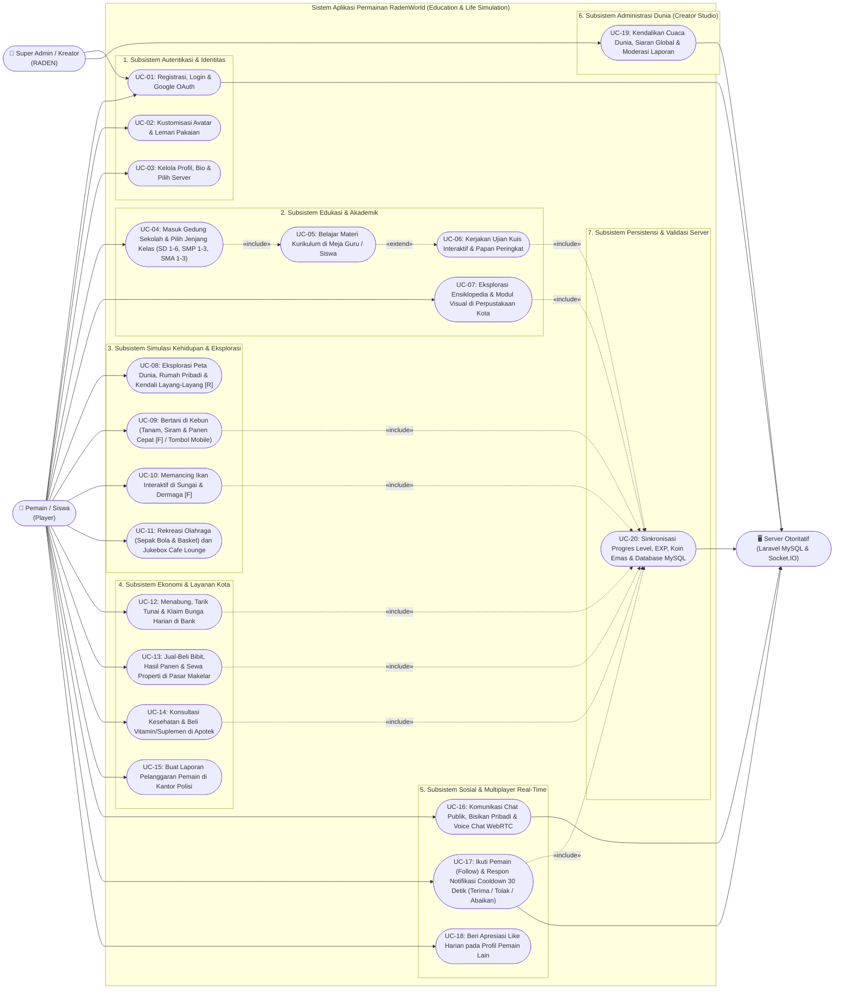

# Dokumen 1: Use Case Diagram Sistem Permainan RadenWorld
**Nama Sistem**: RadenWorld — *2D Open World Multiplayer Education & Life Simulation*  
**Genre Permainan**: **Education & Life Simulation** (Edukasi & Simulasi Kehidupan — Non-Kekerasan)  
**Arsitektur**: React 18 + Phaser 3 (Client) | Laravel 11 + MySQL (Authoritative Backend) | Node.js Socket.IO + WebRTC (Multiplayer & Voice Server)

---

## 1. Identifikasi Aktor Sistem (System Actors)

| Kode Aktor | Nama Aktor | Peran & Tanggung Jawab dalam Sistem |
| :--- | :--- | :--- |
| **ACT-01** | **Pemain / Siswa (*Player*)** | Pengguna utama yang menjelajahi kota RadenWorld, belajar materi & mengerjakan kuis di Sekolah (SD/SMP/SMA) dan Perpustakaan Kota, menjalankan simulasi kehidupan (bertani, memancing, menabung di Bank, berbelanja di Pasar/Apotek, menerbangkan layang-layang), serta berinteraksi sosial (Chat, Voice Chat WebRTC, Mengikuti/Teman). |
| **ACT-02** | **Super Admin / Kreator (`RADEN`)** | Pengelola tertinggi sistem yang memiliki akses ke **Creator Studio (Tahta Agung)** untuk menyiarkan pengumuman server global, mengubah cuaca dunia secara *real-time*, mengatur hak akses peran (*Role*), serta menindak laporan pelanggaran pemain di Kantor Polisi. |
| **ACT-03** | **Sistem Otoritatif & Jaringan (*Backend & Multiplayer Server*)** | Aktor sistem sekunder (*Laravel MySQL API & Socket.IO Server*) yang memvalidasi transaksi dompet anti-cheat, menyimpan progres Level/EXP/Inventaris/Pohon Tani, menyinkronkan pergerakan multi-pemain 20Hz, dan menyalurkan sinyal WebRTC Voice & notifikasi sosial. |

---

## 2. Diagram Use Case Utama (Mermaid Flowchart UML)

> [!NOTE]
> Diagram di bawah ini memetakan seluruh **Use Case** pada aplikasi **RadenWorld (Education & Life Simulation)** yang dikelompokkan ke dalam 5 subsistem utama, lengkap dengan relasi asosiasi aktor, `<<include>>`, dan `<<extend>>`.



---

## 3. Diagram Use Case Tekstual (Standar Dokumentasi Akademik)

```text
+---------------------------------------------------------------------------------------------------+
|                   SISTEM PERMAINAN RADENWORLD (EDUCATION & LIFE SIMULATION)                       |
|                                                                                                   |
|  +---------------------------------------------------------------------------------------------+  |
|  | [A] MODUL AUTENTIKASI & IDENTITAS                                                           |  |
|  |   (UC-01) Login / Registrasi / Google OAuth  ----<<include>>----> (UC-20) Sinkronisasi DB   |  |
|  |   (UC-02) Kustomisasi Avatar & Lemari Pakaian                                               |  |
|  |   (UC-03) Kelola Profil, Bio, Usia & Pilih Server (Asia 1-4)                                |  |
|  +---------------------------------------------------------------------------------------------+  |
|                                                                                                   |
|  +---------------------------------------------------------------------------------------------+  |
|  | [B] MODUL EDUKASI & AKADEMIK (CORE EDUCATION)                                               |  |
|  |   (UC-04) Pilih Jenjang & Kelas Sekolah (SD 1-6, SMP 1-3, SMA 1-3)                          |  |
|  |      |--- <<include>> ---> (UC-05) Belajar Materi Pelajaran di Meja Guru/Siswa (+EXP)       |  |
|  |      |--- <<extend>>  ---> (UC-06) Kerjakan Kuis Ujian & Submit Skor Leaderboard (+Gold)    |  |
|  |   (UC-07) Baca Modul Ensiklopedia & Infografis di Perpustakaan Kota (+EXP)                  |  |
|  +---------------------------------------------------------------------------------------------+  |
|                                                                                                   |
|  +---------------------------------------------------------------------------------------------+  |
|  | [C] MODUL SIMULASI KEHIDUPAN & REKREASI (CORE LIFE SIMULATION)                              |  |
|  |   (UC-08) Eksplorasi Peta Kota 2D, Rumah Pribadi & Mode Terbang Layang-Layang [R]           |  |
|  |   (UC-09) Bertani: Tanam Bibit, Siram Air & Panen Cepat ([F] / Tombol Mobile "PANEN")       |  |
|  |   (UC-10) Memancing Ikan: Lempar Kail [F], Tarik Minigame & Koleksi Ikan (+Gold & +EXP)     |  |
|  |   (UC-11) Bermain Lapangan Olahraga (Bola/Basket) & Putar Lagu Jukebox di Cafe Lounge       |  |
|  +---------------------------------------------------------------------------------------------+  |
|                                                                                                   |
|  +---------------------------------------------------------------------------------------------+  |
|  | [D] MODUL EKONOMI & LAYANAN PUBLIK KOTA                                                     |  |
|  |   (UC-12) Layanan Perbankan: Setor Tabungan, Tarik Tunai & Klaim Bunga Harian 5%            |  |
|  |   (UC-13) Pasar & Makelar: Beli Bibit, Jual Hasil Panen/Ikan & Sewa Properti Kota           |  |
|  |   (UC-14) Apotek Kota: Konsultasi Kesehatan & Beli Vitamin/Suplemen Stamina                 |  |
|  |   (UC-15) Kantor Polisi: Kirim Laporan Pelanggaran Komunitas ke Database                    |  |
|  +---------------------------------------------------------------------------------------------+  |
|                                                                                                   |
|  +---------------------------------------------------------------------------------------------+  |
|  | [E] MODUL SOSIAL & MULTIPLAYER REAL-TIME                                                    |  |
|  |   (UC-16) Chat Publik, Whisper Pribadi, Emote & Open Mic Voice Chat Jernih (WebRTC)         |  |
|  |   (UC-17) Ikuti Pemain (Follow) & Notifikasi Interaktif Cooldown 30 Detik:                  |  |
|  |           -> Pilihan Respon: [TERIMA] (Mutual Teman) / [TOLAK] / [ABAIKAN] / (Hangus 30d)   |  |
|  |   (UC-18) Berikan Apresiasi "Like" Harian pada Profil Pemain Lain                           |  |
|  +---------------------------------------------------------------------------------------------+  |
|                                                                                                   |
|  +---------------------------------------------------------------------------------------------+  |
|  | [F] MODUL ADMINISTRASI (KHUSUS SUPER ADMIN)                                                 |  |
|  |   (UC-19) Creator Studio: Ubah Cuaca Global, Broadcast Server & Moderasi Laporan            |  |
|  +---------------------------------------------------------------------------------------------+  |
+---------------------------------------------------------------------------------------------------+
```

---

## 4. Spesifikasi Detail Use Case Utama

| Kode | Nama Use Case | Aktor | Kondisi Awal (*Precondition*) | Alur Utama (*Main Flow*) | Kondisi Akhir (*Postcondition*) |
| :--- | :--- | :--- | :--- | :--- | :--- |
| **UC-04 & UC-06** | **Belajar & Ujian Kuis Sekolah (SD, SMP, SMA)** | Pemain, Server | Pemain berada di depan pintu Gedung SD, SMP, atau SMA di dunia terbuka. | 1. Pemain menekan `[E]` / tombol `AKSI` pada pintu sekolah.<br>2. Sistem menampilkan modal pilihan kelas (SD 1–6, SMP 1–3, SMA 1–3).<br>3. Pemain masuk ke ruang kelas, berinteraksi dengan Meja Guru/Siswa, membaca materi pelajaran (+EXP), dan mengerjakan Kuis Pilihan Ganda.<br>4. Sistem menghitung nilai kuis, memberikan hadiah Koin Emas & EXP, serta menyimpan skor ke papan peringkat MySQL (`/api/game/leaderboard/submit`). | Level, EXP, Koin Emas, dan skor rapor akademik pemain tersimpan permanen di MySQL. |
| **UC-09** | **Bertani & Panen Cepat (`[F]` / Tombol Mobile)** | Pemain, Server | Pemain berada di area Kebun Tani dengan tanaman berstatus matang (`stage === 3`). | 1. Pemain mendekati petak tanaman matang dalam radius panen.<br>2. Sistem mendeteksi tanaman siap panen (`near-ripe-crop-changed`) dan mengubah tombol alat mobile menjadi `🌾 PANEN`.<br>3. Pemain menekan shortcut `[F]`, `[E]`, atau mengetuk tombol `🌾 PANEN` di layar mobile (meskipun sedang memegang Joran Pancing/alat lain).<br>4. Sistem menambahkan hasil panen ke tas, memberikan `+25 EXP`, dan menyimpan perubahan lahan ke `/api/world/trees`. | Hasil panen masuk ke inventaris, EXP bertambah & naik level jika memenuhi ambang batas, serta petak kebun siap ditanami kembali. |
| **UC-12** | **Manajemen Keuangan di Bank Kota** | Pemain, Server | Pemain masuk ke Gedung Bank RadenWorld atau berinteraksi dengan Teller Bank. | 1. Pemain memilih menu Setor Tunai (*Deposit*), Tarik Tunai (*Withdraw*), atau Klaim Bunga Harian (5%).<br>2. Sistem memvalidasi saldo Koin Emas dompet & tabungan melalui `/api/user/wallet/sync`.<br>3. Sistem mencatat riwayat mutasi transaksi. | Saldo dompet aktif dan saldo rekening tabungan pemain tersinkronisasi secara otoritatif di MySQL. |
| **UC-17** | **Mengikuti Pemain & Notifikasi Cooldown 30 Detik** | Pemain A, Pemain B, Server | Pemain A membuka profil Pemain B di dunia terbuka dan menekan tombol **Ikuti (Follow)**. | 1. Sistem mencatat status mengikuti di database (`/api/social/follow`) dan mengirim paket Socket.IO `player:follow` ke Pemain B.<br>2. Di layar Pemain B muncul pop-up **Notifikasi Mengikuti/Pertemanan** dengan **hitung mundur 30 detik (Cooldown)**. Pemain B memiliki 3 tombol:<br>   • **TERIMA**: Otomatis mengikuti balik Pemain A; keduanya resmi berstatus **Teman (Mutual Follow)**.<br>   • **TOLAK**: Menolak diikuti; menghapus Pemain A dari daftar pengikut dan membatalkan follow di sisi Pemain A.<br>   • **ABAIKAN** / **Hangus (30 detik habis)**: Pop-up tertutup; Pemain A tetap tercatat sebagai pengikut satu arah (*Follower*). | Relasi sosial (`friends`, `following`, `followers`) kedua pemain tersimpan di MySQL dan diperbarui secara *real-time* di HUD & Profil. |

