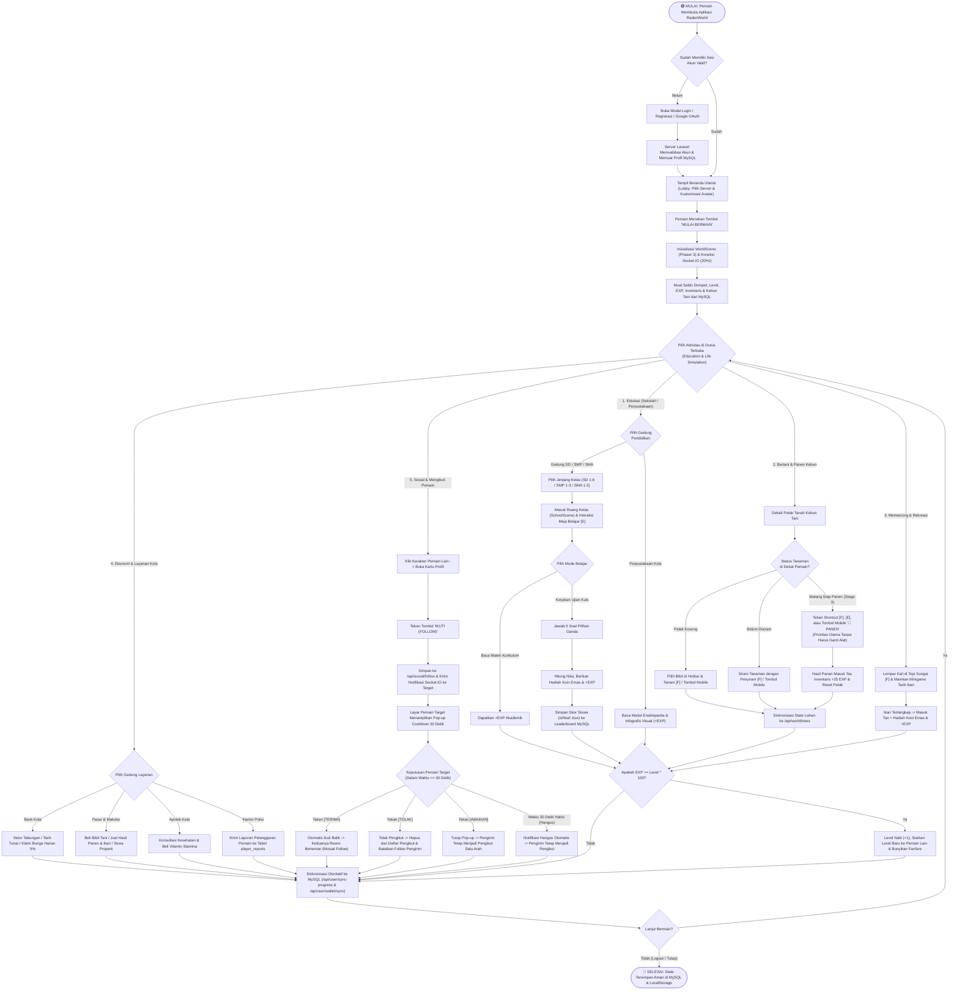

# Dokumen 2: Activity Diagram & User Flow Diagram Sistem Permainan RadenWorld
**Nama Sistem**: RadenWorld — *2D Open World Multiplayer Education & Life Simulation*  
**Genre Permainan**: **Education & Life Simulation** (Edukasi & Simulasi Kehidupan)

---

## 1. Activity Diagram Utama (Cross-Functional Swimlane & User Flow)

> [!IMPORTANT]
> Diagram di bawah ini menggambarkan alur aktivitas lengkap (*End-to-End Activity & User Flow Diagram*) dari saat pemain membuka aplikasi di Beranda, masuk ke dunia simulasi terbuka, menjalankan siklus **Edukasi**, **Simulasi Kehidupan (Panen `[F]`/Mobile, Memancing, Ekonomi)**, hingga **Interaksi Sosial (Follow Cooldown 30 Detik: Terima / Tolak / Abaikan / Hangus)** dan **Sinkronisasi Database MySQL**.



---

## 2. Diagram Alur Swimlane Tekstual (Pemain — Antarmuka Client — Server Database)

```text
+----------------------------------+--------------------------------------+--------------------------------------+
|        PEMAIN (PENGGUNA)         |   CLIENT GAME (REACT + PHASER 3)     |   SERVER (LARAVEL MYSQL & SOCKET)    |
+----------------------------------+--------------------------------------+--------------------------------------+
| 1. Buka aplikasi & Login Akun    | -> Validasi input & panggil API      | -> Cek kredensial di tabel `users`   |
|                                  | <- Terima profil, Level, EXP, Koin   | <- Kirim JSON profil + token         |
|                                  |                                      |                                      |
| 2. Klik "MULAI BERMAIN"          | -> Muat WorldScene & hubungkan       | -> Daftarkan socket ke room dunia    |
|    di Beranda Utama              |    Socket.IO + WebRTC Voice          |    & broadcast posisi 20Hz           |
|                                  |                                      |                                      |
| 3. Masuk Sekolah (SD/SMP/SMA)    | -> Tampilkan SchoolGradeSelectModal  |                                      |
|    & kerjakan Kuis di Meja       | -> Hitung nilai kuis, pancarkan      | -> Simpan skor (`isReal: true`)      |
|                                  |    `gain-exp` & `quiz-gold-earned`   | -> Update `exp`, `level`, & `gold`   |
|                                  |                                      |    di MySQL secara otoritatif        |
|                                  |                                      |                                      |
| 4. Dekati tanaman matang di      | -> Deteksi `hasRipeCropNearPlayer`   |                                      |
|    Kebun & tekan [F] atau        | -> Ubah tombol mobile jadi "PANEN"   |                                      |
|    tombol mobile "🌾 PANEN"      | -> Eksekusi panen instan +25 EXP     | -> Simpan state kebun ke             |
|                                  |    meski memegang alat pancing       |    `/api/world/trees` & `sync-progress`|
|                                  |                                      |                                      |
| 5. Klik Pemain Lain & tekan      | -> Update state optimistik & kirim   | -> Simpan ke tabel `social_follows`  |
|    tombol "IKUTI (FOLLOW)"       |    event `player:follow`             | -> Teruskan event `player:followed_by`|
|                                  |                                      |    ke klien Pemain Target            |
|                                  |                                      |                                      |
| 6. Pemain Target melihat Pop-up  | -> Jalankan timer mundur 30 detik:   |                                      |
|    Notifikasi Cooldown 30 Detik  |    - Klik [TERIMA]  -> Follow balik  | -> Catat Mutual Follow (Teman Resmi) |
|    (Terima / Tolak / Abaikan)    |    - Klik [TOLAK]   -> Hapus pengikut| -> Hapus baris di `social_follows`   |
|                                  |    - Klik [ABAIKAN] / 30d Hangus     | -> Pertahankan pengikut satu arah    |
+----------------------------------+--------------------------------------+--------------------------------------+
```

---

## 3. Penjelasan Tahapan User Flow

1. **Tahap Orientasi & Masuk Dunia (`HomeScreen` -> `WorldScene`)**:
   - Pemain masuk menggunakan akun terdaftar atau Google OAuth. Sistem memuat `level`, `exp`, `gold`, `diamonds`, dan kustomisasi avatar langsung dari database MySQL melalui `/api/user/wallet` tanpa pernah mereset level kembali ke 1.
2. **Siklus Edukasi Akademik (`SchoolScene` & `LibraryScene`)**:
   - Pemain memilih gedung **SD (Kelas 1–6)**, **SMP (Kelas 1–3)**, **SMA (Kelas 1–3)**, atau **Perpustakaan Kota**.
   - Membaca materi kurikulum dan menyelesaikan kuis memberikan **EXP** dan **Koin Emas** yang langsung meningkatkan Level pemain (`kebutuhan EXP = Level * 100`) serta mencatat nama siswa di Papan Peringkat Sekolah.
3. **Siklus Simulasi Kehidupan & Produksi (`WorldFarming` & `FishingMinigame`)**:
   - Pemain menanam bibit, menyiram tanaman, dan ketika tanaman matang (`stage === 3`), sistem secara otomatis mengaktifkan indikator siap panen. Pemain cukup menekan **`[F]`** di PC atau tombol **`🌾 PANEN`** di layar sentuh mobile untuk langsung memanen tanpa perlu melepas Joran Pancing dari tangan.
   - Hasil panen dan tangkapan ikan dapat dijual di **Pasar & Makelar** untuk memperoleh Koin Emas, lalu ditabung di **Bank Kota** untuk mendapatkan bunga harian 5%.
4. **Siklus Interaksi Sosial & Notifikasi Mengikuti 30 Detik (`FriendRequestNotification`)**:
   - Saat Pemain A mengikuti Pemain B, Pemain B menerima pop-up notifikasi dengan **cooldown 30 detik (otomatis hangus setelah 30 detik)** beserta 3 opsi: **TERIMA** (otomatis mengikuti balik dan menjadi Teman), **TOLAK** (menolak diikuti dan menghapus dari daftar pengikut), atau **ABAIKAN** (menutup notifikasi dan membiarkan Pemain A sebagai pengikut).

